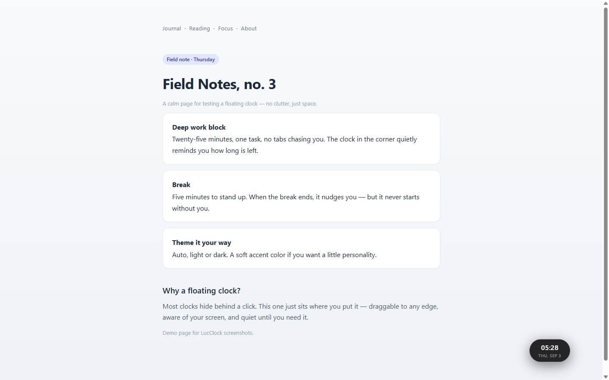
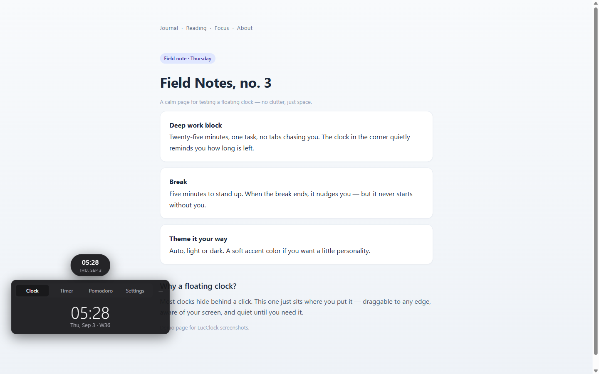
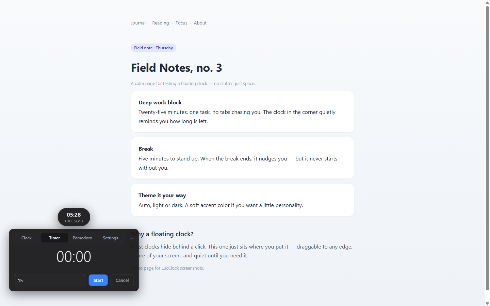
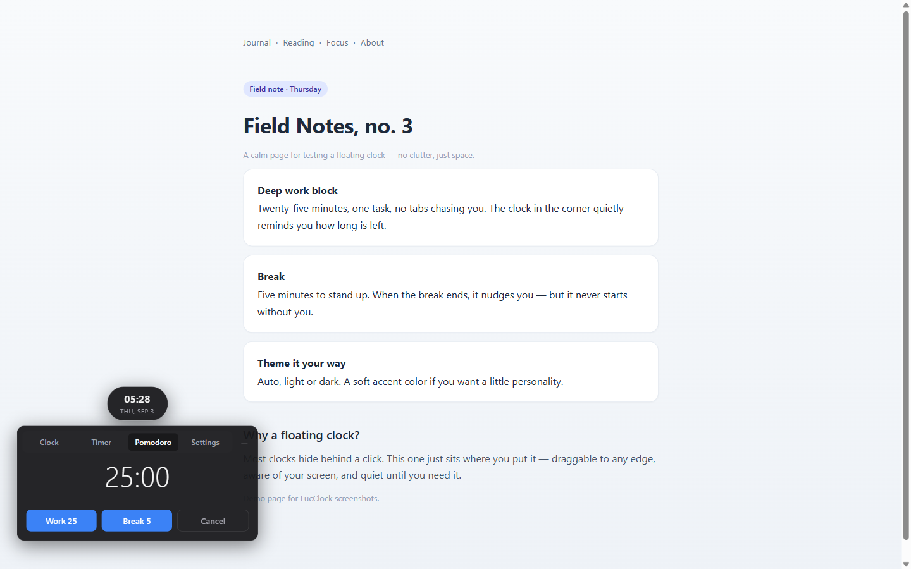
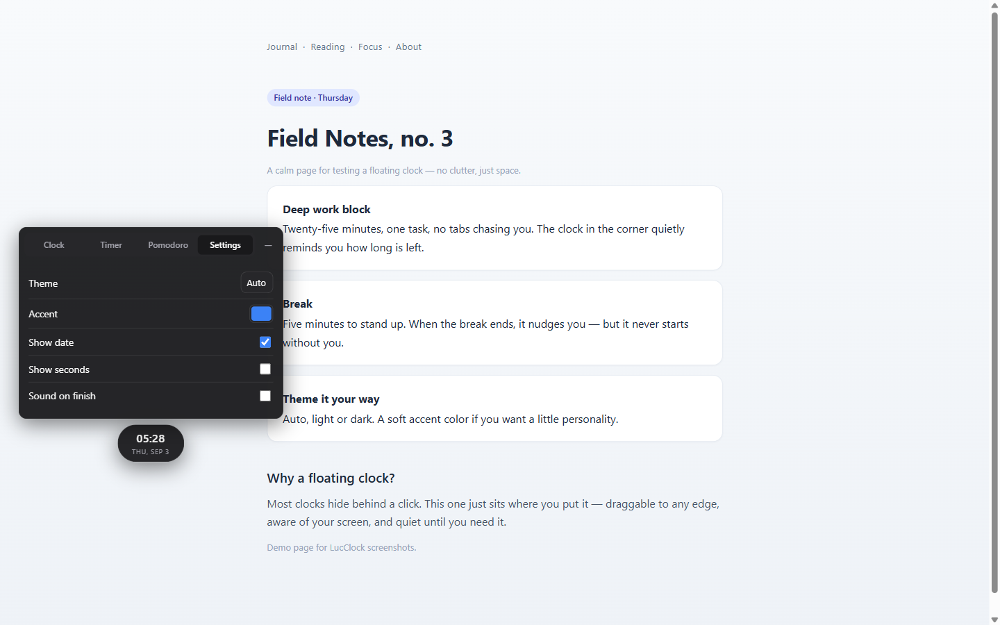
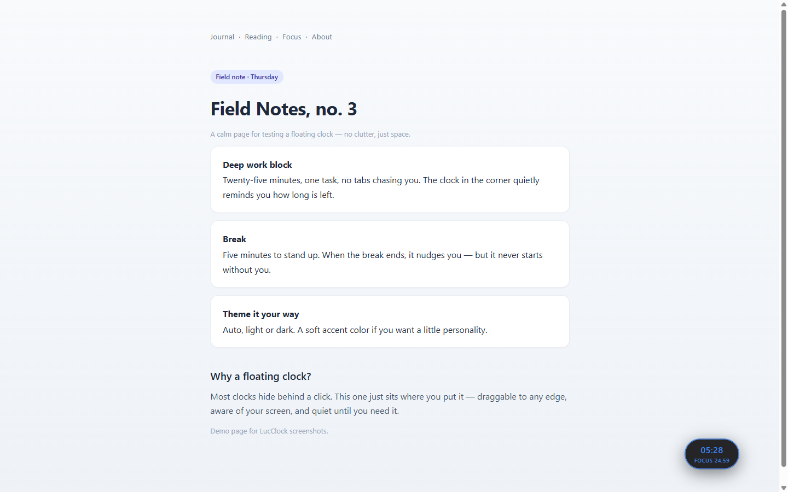

<div align="center">

# LucClock

**A calm, minimal clock for your browser — with a timer and pomodoro, floating on every tab.**

Built by **Lucas (Aizzul Luqman)** · Open to contributions

</div>

---

## What it is

LucClock is a lightweight browser extension (Manifest V3) that puts a quiet, draggable
**24-hour clock** in the corner of your screen — on every tab, every site. It stays out of
your way until you need it, then expands into a clean panel with:

- **Clock** — live 24-hour time, date + ISO week line, optional seconds
- **Timer** — count down minutes; get a desktop notification when time's up
- **Pomodoro** — Work 25 / Break 5 focus sessions
- **Settings** — Auto/Light/Dark theme, accent color, date & seconds toggles, sound

While a countdown runs, the pill swaps its date line for the live remaining time
(`FOCUS 24:12`) so the bubble never bloats. Drag it to **any** screen edge — the panel
smartly repositions and flips upward near the bottom so it always stays on-screen.

**One clock across every tab.** LucClock is deliberately *not* a per-tab widget: start a
pomodoro, open the panel, switch to the timer tab, or drag the bubble in any tab and every
other open tab follows instantly — they're all views of the same shared state. Close or
switch tabs freely; the clock and your timers are never "stuck" on the page you started them.

> Works in **Brave** and other Chromium browsers (Chrome, Edge, Opera, Arc).

## Screenshots

<p align="center">
  
  &nbsp;&nbsp;
  
</p>

<p align="center">
  
  &nbsp;&nbsp;
  
</p>

<p align="center">
  
  &nbsp;&nbsp;
  
</p>

## Why LucClock?

Clocks are everywhere, but few exist as a *polished, always-available floating extension* —
most are browser-UI mods or clunky popups. LucClock is a deliberate, calm little tool:

- **Truly floating** — pinned to the corner of every page you visit
- **24-hour by default** — clean, unambiguous, readable at a glance
- **Timer + pomodoro that survive tab switches** — alarms run in the background worker
- **Isolated & safe** — injected in a shadow DOM so it never touches page styles or scripts
- **Accessible & keyboard-friendly** — Esc, arrow keys, focus outlines, reduced-motion aware

## Download & install (no clone needed)

**1. Grab the latest package**

Download the newest release zip from the
**[Releases](https://github.com/itsLucas02/LucClock/releases)** page — it's a ready-to-load
package (no building, no dependencies). You can also grab it from the assets under each
release tag.

**2. Unzip it**

Extract the zip somewhere permanent, e.g. `~/LucClock` or `Documents/LucClock`.
Keep that folder — the browser reads from it.

**3. Load it into Brave (or Chrome / Edge / Arc)**

1. Open `brave://extensions` — or `chrome://extensions` in other Chromium browsers.
2. Toggle **Developer mode** on (top-right corner).
3. Click **Load unpacked**.
4. Select the `lucclock-<version>` folder you unzipped.
5. Done — the clock bubble appears at the bottom-right of every page.

To **update** later, unzip the new version over the folder and click the **Reload** icon on
the extension card in `brave://extensions`.

> **Want to run from source instead?** Clone this repo and do the same *Load unpacked* steps,
> selecting the repo folder. It's plain JavaScript with no build step.

## Using it

| Do this | Result |
|---|---|
| Click the bubble | Open/close the panel |
| Drag the bubble | Move it to any edge; position is remembered |
| **Timer** tab → minutes → Start | Desktop notification on finish |
| **Pomodoro** tab → Work 25 / Break 5 | Focus session with notification |
| **Settings** | Theme, accent, date/seconds, sound on finish |
| Press `Esc` with panel open | Collapse it |
| `←` / `→` / Home / End on a tab | Move between Clock/Timer/Pomodoro/Settings |

## Project layout

```
LucClock/
├── manifest.json            # MV3: content script, background worker, permissions
├── icons/                   # 16/48/128 px extension icons
├── brand/                   # Brand assets (SVG mark)
├── lib/
│   └── storage.js           # Settings / countdown / position persistence
├── content/
│   └── content.js           # Self-contained widget: UI, drag, panel flip, clock, keyboard
└── background/
    ├── service-worker.js    # chrome.alarms + notifications + chime trigger
    ├── offscreen.html       # MV3 audio playback surface
    └── chime.wav            # Soft completion chime
```

## Contributing

Contributions are welcome — bug reports, ideas, docs, and pull requests. See
[CONTRIBUTING.md](CONTRIBUTING.md) to get started. Please read our
[Code of Conduct](CONTRIBUTING.md#code-of-conduct) and note all work is MIT licensed.

## License

[MIT](LICENSE) © Aizzul Luqman (Lucas)
